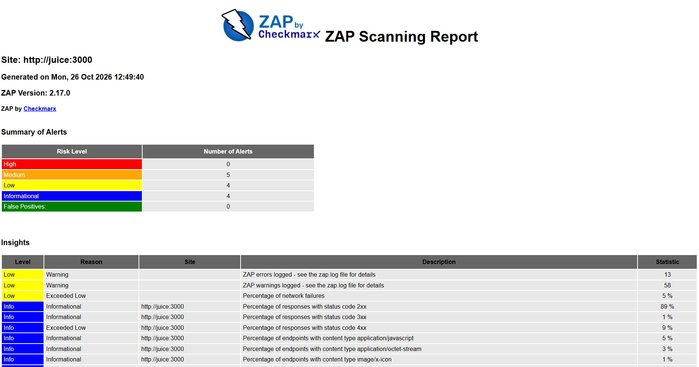
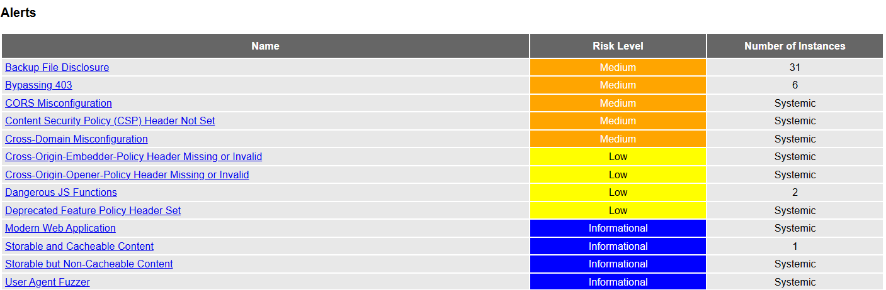
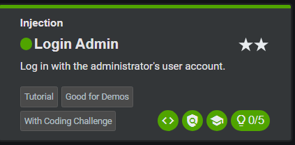
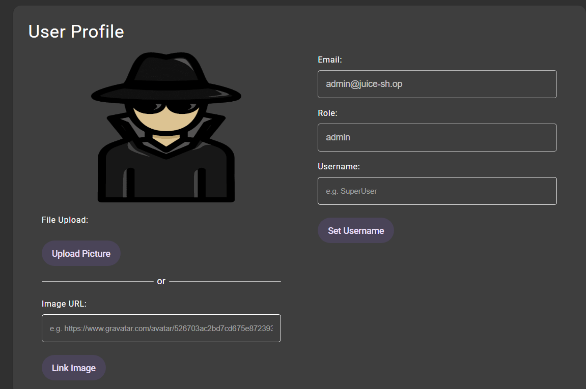
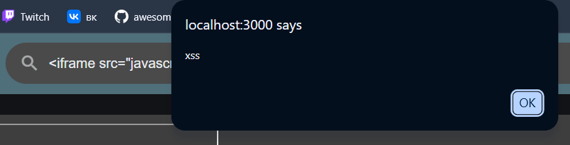
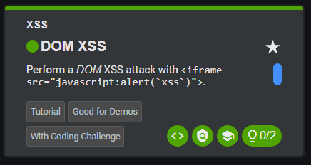

# Отчёт по лабораторным работам №3–4

**Федеральное государственное автономное образовательное учреждение высшего образования «Национальный исследовательский университет ИТМО»**

Дисциплина: «Информационная безопасность»
Работа 3–4: Динамический анализ защищённости (DAST) и моделирование угроз (STRIDE)
ФИО: Чураков А. А.
Номер группы: P3431
Год: 2026

---

## Цель работы

Провести динамический анализ защищённости веб-приложения OWASP Juice Shop с помощью OWASP ZAP, подтвердить уязвимости вручную и построить модель угроз по методологии STRIDE.

## 1. Стенд и инструменты

Приложение **OWASP Juice Shop** (SPA на Angular, REST API на Node.js/Express, БД SQLite) развёрнуто в Docker:

```bash
docker run -d --name juice -p 3000:3000 bkimminich/juice-shop
```

Динамический анализ выполнен сканером **OWASP ZAP 2.17.0** в режиме full scan (паук + Ajax Spider + активное сканирование). Полный отчёт сканера — `zap/zap-report.html`.

```bash
docker run --rm --network labnet -v "$PWD:/zap/wrk:rw" \
  ghcr.io/zaproxy/zaproxy:stable \
  zap-full-scan.py -t http://juice:3000 -r zap-report.html -J zap-report.json
```

## 2. Результаты сканирования (DAST)

Сканирование выявило **5 уязвимостей уровня Medium** и ряд Low/Informational.



*Скриншот 1 — отчёт ZAP, сводка находок (Summary of Alerts): 5 Medium, 4 Low, 4 Informational*



*Скриншот 2 — отчёт ZAP, перечень находок (Alerts)*

Основные находки:

| # | Находка | Risk | CWE | OWASP Top 10 |
|---|---|---|---|---|
| 1 | Content Security Policy (CSP) Header Not Set | Medium | CWE-693 | A05:2021 — Security Misconfiguration |
| 2 | CORS Misconfiguration | Medium | CWE-942 | A05:2021 — Security Misconfiguration |
| 3 | Cross-Domain Misconfiguration | Medium | CWE-264 | A05:2021 — Security Misconfiguration |
| 4 | Backup File Disclosure | Medium | CWE-530 | A05:2021 — Security Misconfiguration |
| 5 | Bypassing 403 | Medium | CWE-348 | A01:2021 — Broken Access Control |

**Разбор находок:**

1. **CSP Header Not Set** — не задан заголовок `Content-Security-Policy`, браузеру нечем ограничить исполнение внедрённого скрипта. Главный усиливающий фактор для XSS. *Контрмера:* строгая политика `default-src 'self'`, запрет `unsafe-inline`.
2. **CORS Misconfiguration** — сервер разрешает обращения к API со сторонних источников. Вредоносный сайт может читать ответы API от имени жертвы. *Контрмера:* белый список доверенных источников.
3. **Cross-Domain Misconfiguration** — слишком широкая политика междоменного доступа, утечка данных на сторонние домены. *Контрмера:* ограничить разрешённые домены.
4. **Backup File Disclosure** — доступны резервные/служебные файлы, которые могут содержать код и секреты. *Контрмера:* убрать такие файлы из веб-каталога.
5. **Bypassing 403** — ресурсы с ответом `403 Forbidden` удаётся получить обходом (регистр, лишние сегменты пути). *Контрмера:* контроль доступа по нормализованному пути на сервере.

## 3. Подтверждение SQLi и XSS

Уязвимости классов SQL Injection и XSS подтверждены вручную. Факт выполнения фиксирует встроенная система заданий **Score Board** — при успехе отметка загорается зелёным.

### 3.1. SQL Injection (задание «Login Admin»)

Инъекция в поле Email формы входа отбрасывает проверку пароля — выполнен вход под учётной записью администратора (`admin@juice-sh.op`, роль `admin`).



*Скриншот 3 — задание «Login Admin» зачтено на Score Board (категория Injection)*



*Скриншот 4 — профиль администратора (admin@juice-sh.op, роль admin)*

### 3.2. Cross-Site Scripting (задание «DOM XSS»)

Внедрение HTML через поле поиска привело к исполнению скрипта в браузере (DOM-based XSS: ввод попадает в DOM без экранирования).



*Скриншот 5 — внедрённый скрипт выполнен в браузере*



*Скриншот 6 — задание «DOM XSS» зачтено на Score Board (категория XSS)*

## 4. Моделирование угроз (STRIDE)

### 4.1. Диаграмма потоков данных (DFD)

```
                 ┌──────────────────────────────────────────────┐
                 │          ДОВЕРЕННАЯ ГРАНИЦА (сервер)           │
  ┌─────────┐    │   ┌──────────────┐        ┌───────────────┐   │
  │ Пользо- │ 1  │   │  REST API    │   3    │  База данных  │   │
  │ ватель  │───────▶│ (Express)    │───────▶│  (SQLite)     │   │
  │(браузер)│◀───────│              │◀───────│               │   │
  └─────────┘ 2  │   └──────────────┘   4    └───────────────┘   │
                 └──────────────────────────────────────────────┘

  1 — HTTP-запрос (логин, поиск)   3 — SQL-запрос
  2 — HTTP-ответ (данные, JWT)     4 — результат выборки
```

### 4.2. Анализ по STRIDE

| Категория | Угроза | Пример в Juice Shop |
|---|---|---|
| **S** — Spoofing | Выдача себя за другого | Вход через SQLi в обход пароля, перехват JWT-токена |
| **T** — Tampering | Подмена данных | SQL-инъекция, изменение цены/количества на стороне клиента |
| **R** — Repudiation | Отказ от авторства | Недостаточное журналирование действий |
| **I** — Information Disclosure | Раскрытие данных | Backup File Disclosure, CORS, кража данных через XSS |
| **D** — Denial of Service | Отказ в обслуживании | «Тяжёлые» запросы, отсутствие ограничения частоты |
| **E** — Elevation of Privilege | Повышение привилегий | Bypassing 403, доступ к админ-функциям |

### 4.3. Детальная угроза (Information Disclosure)

Связка **XSS + отсутствие CSP**: внедрённый скрипт исполняется без ограничений (CSP не задан — находка 1), получает данные сессии и отправляет их на внешний сервер, а широкий CORS (находки 2, 3) облегчает обращение к API от имени жертвы. *Контрмеры:* строгая CSP, экранирование вывода, флаги `HttpOnly`/`Secure`/`SameSite`, белый список CORS.

## 5. Таблица рисков

Оценка CVSS — по базовой метрике CVSS v3.1 (ориентировочно).

| Уязвимость | Risk | CVSS | OWASP Top 10 | Контрмера |
|---|---|---|---|---|
| SQL Injection (форма входа) | High | 9.8 | A03:2021 — Injection | Параметризованные запросы / ORM |
| Cross-Site Scripting (XSS) | High | 6.1 | A03:2021 — Injection | Экранирование вывода + CSP |
| CSP Header Not Set | Medium | 6.5 | A05:2021 — Misconfiguration | Строгая политика CSP |
| CORS Misconfiguration | Medium | 5.3 | A05:2021 — Misconfiguration | Белый список источников |
| Cross-Domain Misconfiguration | Medium | 5.3 | A05:2021 — Misconfiguration | Белый список доменов |
| Backup File Disclosure | Medium | 5.3 | A05:2021 — Misconfiguration | Удаление служебных файлов |
| Bypassing 403 | Medium | 5.3 | A01:2021 — Broken Access Control | Контроль доступа на сервере |

## 6. Рекомендации

1. Внедрить строгую **Content-Security-Policy** — снижает результативность XSS.
2. Перейти на **параметризованные запросы / ORM** и валидацию ввода — закрывает SQLi.
3. Ограничить **CORS** белым списком доверенных доменов.
4. Реализовать **контроль доступа на сервере** и убрать резервные файлы из веб-каталога.
5. Добавить защитные **HTTP-заголовки** (`HttpOnly`, `Secure`, `SameSite`, HSTS) и **ограничение частоты запросов**.

## Контрольные вопросы

**1. Почему динамический анализ (DAST) не может гарантировать отсутствие уязвимостей?**
DAST тестирует только пути и входные точки, до которых «дотянулся» во время сканирования, не видя исходного кода. Уязвимости в неохваченной логике или за сложной аутентификацией остаются незамеченными. Отсутствие находок означает лишь, что инструмент их не нашёл.

**2. Как связаны уязвимость (XSS) и категория STRIDE (Spoofing)?**
Уязвимость — это способ реализовать угрозу. XSS позволяет похитить сессионный токен жертвы, после чего злоумышленник выдаёт себя за неё — то есть XSS служит средством реализации угрозы Spoofing (и Information Disclosure).

**3. Чем базовая метрика CVSS (Base) отличается от Temporal и Environmental?**
Base описывает неизменные свойства уязвимости (вектор, сложность, влияние). Temporal учитывает меняющиеся во времени факторы (наличие эксплойта, патча). Environmental корректирует оценку под среду организации (критичность актива, компенсирующие меры).

**4. На каком этапе разработки эффективнее всего применять моделирование угроз?**
На этапе проектирования, до написания кода: защитные меры закладываются в архитектуру, а исправление дефектов проектирования на поздних этапах обходится многократно дороже.

## Вывод

Приложение OWASP Juice Shop развёрнуто в Docker и проанализировано сканером OWASP ZAP: выявлено 5 уязвимостей уровня Medium (в основном некорректная конфигурация безопасности и нарушение контроля доступа). Уязвимости SQL Injection и XSS подтверждены вручную через Score Board. Построена модель угроз (DFD и анализ по STRIDE), результаты сведены в таблицу рисков с оценкой CVSS и привязкой к OWASP Top 10, сформулированы приоритетные рекомендации по устранению.
